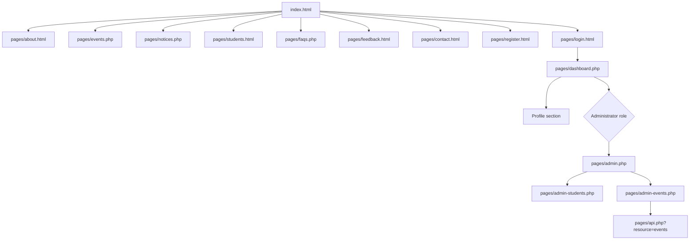
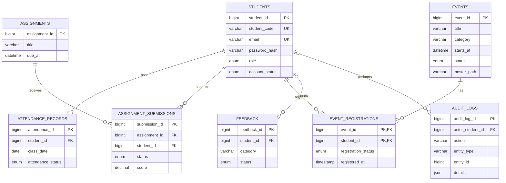

# Student Hub project guide

Student Hub is a PHP/MySQL student portal with a responsive, grayscale interface. Public directory and FAQ content is loaded from JSON with Fetch; authenticated student services and administrator changes are stored in MySQL.

## Run locally

1. Start Apache and MySQL from the XAMPP Control Panel.
2. Import `student_hub.sql` using phpMyAdmin. The script creates the database, tables, initial events/notices, the administrator account, and 20 student-role records (one active sample and 19 inactive samples).
3. For local defaults, the app connects to `localhost:3306` as `root` with no password. For other environments set `DB_HOST`, `DB_PORT`, `DB_NAME`, `DB_USER`, and `DB_PASSWORD`.
4. The seeded administrator is `admin@studenthub.edu`, but the SQL file intentionally does not provide a shared plaintext password. Set a private password before first login: run `php -r "echo password_hash('YOUR-PRIVATE-PASSWORD', PASSWORD_DEFAULT), PHP_EOL;"`, then update the `password_hash` for `admin@studenthub.edu` in phpMyAdmin with the generated hash. The password must be 8–72 bytes. Never use a shared/default password in a deployed environment.
5. Open `http://localhost/student%20Hub/`. Sign in with the seeded admin email and the private password you configured; successful admin sign-in opens `pages/admin.php`. Student accounts go to `pages/dashboard.php`, and direct access to admin pages/API is denied unless the active account has the `admin` role. AdminLTE and Bootstrap assets are loaded from public CDNs, so the administrator interface needs an internet connection unless those libraries are hosted locally.

Do not use Live Server or `python -m http.server` for PHP pages; use Apache so PHP, sessions, and MySQL are available.

## Main structure

| Path | Responsibility |
| --- | --- |
| `index.html` | Public portal landing page |
| `pages/` | Public, authentication, student, administrator, and JSON API endpoints |
| `styles/` | Page styles, global grayscale theme, and AdminLTE overrides |
| `js/` | Browser interactions, validation, JSON loading, and async administrator UI |
| `data/` | JSON datasets for the public student directory, FAQs, and event examples |
| `uploads/events/` | Validated event poster files; executable scripts are denied by `.htaccess` |
| `student_hub.sql` | Idempotent schema setup and demo data |
| `docs/` | Project guide, navigation map, and database entity relationship model |

## Sitemap

## Data model

## Coursework feature map

| Practical area | Implementation |
| --- | --- |
| Responsive, accessible pages | Semantic page structure, keyboard-operable controls, labels, live status messages, responsive layouts |
| Monochrome UI | Shared black/white/gray theme; AdminLTE 4 dashboard with Bootstrap 5 and grayscale overrides |
| JavaScript interactions | Theme preference, validation, FAQ accordions and search, student directory filtering/sorting/pagination |
| JSON and Fetch | Directory and FAQ fetch, validation, local cache fallback, 20 fictional student directory records |
| PHP processing and file storage | Server-side registration/contact/feedback/profile/RSVP processing and validated event-poster uploads |
| Database and security | MySQLi, prepared statements, password hashing, session timeout, CSRF checks, role checks, audit log |
| Student management | Admin-only paginated search, CSV export, create/edit/password reset, activate/deactivate |
| Event management and API | Admin-only asynchronous event CRUD, poster validation, registration counts, JSON responses, transactional audit logging |
| Admin dashboard | AdminLTE statistics, recent registrations, message moderation, notice publishing, and recent audit activity |

The inactive student sample accounts are coursework fixtures, not login-ready accounts. An administrator must set a password before activating them.
